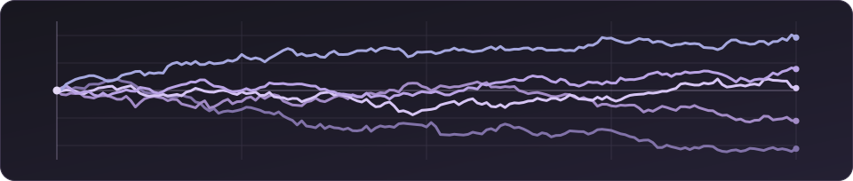

# Hi, I’m Wiktor

I study Mathematics and Artificial Intelligence. Probability is the part of math I keep coming back to. I like using PyTorch to understand deep learning by building the pieces myself, from writing training loops to tracing how a language model generates its next token.

### What I’m exploring

I’m interested in what changes as models get larger. How do you split model weights and training state across devices? What affects memory use and latency during inference?

I’m also curious about coding agents, how their harnesses work, and how AI tools might help with mathematical research. Lately I’ve been exploring physics for fun, too.

[Personal site](https://wiktorzoga.com) · [X](https://x.com/WiktorZoga)
